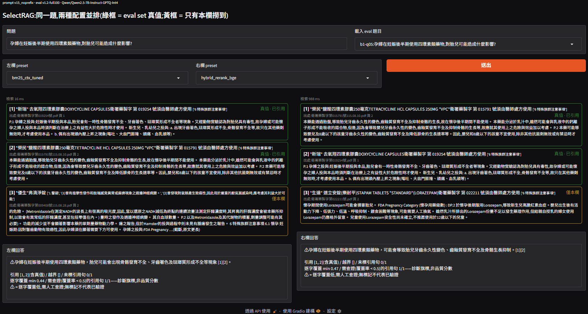

# SelectRAG

**Choosing a RAG Configuration by Controlled Experiment on a Single RTX 4090**
在單卡 RTX 4090 上,用受控對照實驗選出 RAG 配置

**[English](#english)** | **[繁體中文](#繁體中文)**

[](LICENSE)

`Python` · `BM25` · `bge-m3` · `bge-reranker` · `vLLM` · `TensorRT-LLM` · `GPTQ / AWQ / FP8` · `hypothesis` · `Gradio` · `RTX 4090`

---

<a name="english"></a>

## English

> **An answer to "which RAG setup should we run?" that comes with its evidence.** Retrieval strategy, inference engine and numeric format are each changed one at a time with everything else pinned, on one 100-question human-labelled eval set and one machine. Every number reruns with one command.
> Validated on Traditional-Chinese medical public documents (NHI reimbursement rules, drug package inserts, fee schedules). The method is **domain-agnostic**: it fits any setting with a fixed hardware budget where answers must cite their sources.



### TL;DR

- **The deliverable is a decision, not a leaderboard.** An [architecture decision memo](docs/DECISION_MEMO.md) gives each axis a recommended pick, the cost of that pick, and a *boring-but-safe* alternative.
- **Recommendation:** hybrid retrieval (BM25 + bge-m3, RRF) + bge-reranker, served by vLLM with GPTQ-Int4. Against the safe baseline this gives recall@3 0.808 → 0.941 and generation throughput ×2.36.
- **The measuring instruments were audited too.** The faithfulness judge was hand-audited in both directions, the mutation-testing tool was checked for fake kills, and the BM25 baseline was tuned before anything was compared against it.
- **Failures are part of the record.** Nine "expected to win, lost" entries, three prompt revisions (two falsified), and every pivot are written up in the memo and the [devlog](docs/devlog.md).

### 1. The Problem: RAG choices are made by blog post, not by measurement

"Dense beats BM25", "TensorRT-LLM is faster", "4-bit costs accuracy": each of these gets repeated without saying what it was measured against. On a single consumer GPU the axes also interact. The reranker competes with generation for the same card, and the numeric format decides how much KV cache is left.

**SelectRAG does not try to build a better RAG. It builds a way to choose one**: change one axis at a time, pin the rest, report the cost next to the gain, and say what the measurement cannot see.

### 2. Core Method

```
        frozen eval set (100 Qs, human-adjudicated ground truth, content hash)
                                  │
      ┌───────────────────────────┼───────────────────────────┐
      ▼                           ▼                           ▼
  A: retrieval               B: engine                    C: numeric format
  BM25 / dense / hybrid      vLLM vs TensorRT-LLM         bf16 / FP8 / AWQ / GPTQ
  + reranker                 (same model, same prompts)   (same engine)
      │                           │                           │
  recall@k / hit@k / MRR     TTFT, p50/p95, tok/s         throughput, KV cache,
                                                           faithfulness (14B judge)
      └───────────────────────────┼───────────────────────────┘
                                  ▼
            decision memo: one pick + its cost + a boring-but-safe option per axis
```

- **One axis at a time:** only one variable changes between runs, and the rest stay pinned (model revision, seed, prompts, retrieval results).
- **Ground truth is a set:** the same rule often appears verbatim in several documents. Every equivalent chunk counts as correct, so a retriever is not punished for finding "the other copy".
- **Invariants lock the metrics together:** `hit == (recall > 0)` is enforced by property-based tests. Bad data (empty truth set, duplicate id, k < 1) raises instead of silently scoring 0.
- **A single quality gate:** `bash tools/gauntlet.sh` runs tests + coverage → types → lint → mutation testing → real-execution layers → supply chain → random order.

### 3. How it compares to picking by benchmark

**Core argument: a benchmark tells you which configuration won somewhere else. It does not tell you what the win costs on your card, or whether the metric can see your failure modes.**

| | Leaderboard / blog numbers | This project |
|---|---|---|
| Baseline | often default-parameter BM25 | BM25 tuned first (recall@10 0.829 → 0.905 before any dense model) |
| What is reported | the winner | the winner, its cost, and a boring-but-safe option |
| Quality claim | "quality unchanged" | what the judge sees, what it misses, and how far it is off in each direction |
| Reproducibility | a table | one command per number, eval set frozen by hash |

**Why RAG, and not just a long context?** It is the first question to ask in 2026, and on this budget the arithmetic answers it before any experiment. The non-CSV part of the corpus alone is about 675,000 characters, plus 6,350 fee-schedule rows. At a rough estimate of one token per one to one and a half Chinese characters, that is several hundred thousand tokens. The whole card's KV cache holds about 113k tokens in bf16 and 274k in GPTQ-Int4 (measured, axis C), so the corpus cannot be placed into one context on this GPU. The open question is a hybrid: retrieve first, then give the model a much longer context than three passages. That is the D axis, and it is deliberately out of scope. The reason is that the judge is calibrated only for short answers, so long-context output has no trustworthy quality measure yet. The token count is an estimate; the KV figures are measured.

**Why Qwen2.5-7B-Instruct?** Comparing engines and formats needed three things from one model: a bf16 baseline that fits in 24 GB with room left for KV cache, official AWQ and GPTQ checkpoints from the same vendor (so quantization is not our own calibration choice), and loading in both vLLM and TensorRT-LLM. This model met all three when the project started, and it is pinned to one revision. The conclusions are about formats and engines *on this model*. A newer model is a regression re-run, not an assumption. The runs are scripted, so the re-run means changing the model name, not writing new code. Axis A does not depend on the generator at all.

**Why these retrieval models and this judge?** The same rule applied: pinnable open weights that fit on the card next to the generator. *bge-m3* supports multilingual text including Traditional Chinese and indexes all 8,029 chunks offline in 40 seconds. An alternative, NV-Embed-v2, was tried and dropped because its remote code is incompatible with the pinned transformers version. *bge-reranker-v2-m3* is from the same family and needs about 2 GB in-process. It is the one model we actually compared: NVIDIA's NIM reranker tied on recall and was about 18% faster, but it was not adopted because it needs a second container to maintain. The *judge*, Qwen2.5-14B-Instruct-AWQ, is one size above the model it grades, so the generator is not grading itself. AWQ lets it fit in 24 GB. It runs locally, so its version stays pinned and the corpus never leaves the machine, and it supports JSON-schema structured output, so verdicts come back in a fixed format. The judge is from the same model family as the generator. That could bias it, and we have not measured whether it does.

### 4. Engineering trail

Development was a series of **validate → find the problem → correct**:

- ❌ **Rejected before building:** the obvious fix for missed drug names (index the heading path) was checked first. The names were not in the heading path at all, only in the document title line.
- ❌ **Dense alone bought 0.001:** bge-m3 scored recall@10 0.904 against tuned BM25's 0.903. The payoff came from *complementarity*, because the two miss almost disjoint questions, and that is why the recommendation is a hybrid.
- ❌ **A prompt fix made things worse:** a self-check rule ("never claim it isn't mentioned") turned 44 questions that had been answered normally, most of them correctly, into abstentions. For a 7B quantized model, meta-instructions act as string priming, not as behavioural checks.
- 🔧 **The testing tool lied:** mutation testing reported 140/162 kills on the desktop and 85/162 in the cloud for the same code. Re-running one survivor showed fake kills. The tool now verifies its baseline first and records the failing test behind every kill, and both machines agree at 84/162.
- 🔧 **Auditing the judge in both directions:** the judge had only been audited on what it flagged. Auditing what it *passed* found a fourfold dose error marked "supported". The judge's miss rate turned out similar across formats (3/39, 3/35, 3/36), so the relative comparison it is used for holds.

### 5. Results

> Scale: 8,029 chunks from 42 public documents, 100 questions (eval set v1.2), one RTX 4090 (24 GB).

| Axis | Recommended | Key numbers | Boring but safe |
|---|---|---|---|
| A Retrieval | hybrid (BM25 + bge-m3, RRF) + bge-reranker-v2-m3 | recall@10 0.903 → 0.973, recall@3 0.808 → 0.941; cost: 13 ms → 1501 ms per query when sharing the GPU with generation | tuned BM25 with document context: no GPU, 13 ms, recall@10 0.903 |
| B Engine | do FP8 first, argue about engines later | vLLM vs TensorRT-LLM within 10%; FP8 ×1.4–1.7 | vLLM bf16 |
| C Format | vLLM + GPTQ-Int4 (official pre-quantized) | throughput ×2.36 (1000 vs 424 tok/s), 5.3 GiB weights, 2.4× KV-cache headroom | vLLM bf16 |

- **Quantization changes the words, not the groundedness (as far as the judge sees):** only 25% of GPTQ outputs are identical to bf16. After a hand audit of both judge directions, GPTQ shows no extra errors against bf16.
- **The judge has limits, and they are stated:** κ 0.845 on a random calibration set fell to 0.488 on a stratified one. The judge cannot see relations between numbers (per-day vs per-dose), so it is used only for *relative* comparison across formats.
- **Where the BM25 context gain comes from:** document title +0.039, heading path +0.015, both together +0.086 recall@10. The two fields interact.
- **Quality engineering:** 620 tests, 99% coverage, 162/162 mutation anchors killed.

### 6. Transferability

The method fits settings that **simultaneously** meet three conditions: **(1) a fixed hardware budget, (2) answers must cite sources, (3) the choice must be defensible to someone else.**

→ Internal document Q&A, legal and compliance lookup, and technical-manual assistants all qualify. Swap the corpus and eval set, and the axis runner, metrics, judge audit and quality gate stay as they are.

### 7. Tech Stack

- **Retrieval:** BM25 (standard library, CJK bigram), bge-m3, reciprocal-rank fusion, bge-reranker-v2-m3
- **Inference:** vLLM 0.22.1, TensorRT-LLM 1.2.1 (PyTorch backend); Qwen2.5-7B-Instruct in bf16 / FP8 (ModelOpt) / AWQ / GPTQ-Int4
- **Evaluation:** frozen eval set with content hash; recall@k / hit@k / MRR; 14B local faithfulness judge with structured output
- **Quality:** pytest + hypothesis, mypy strict, ruff, mutation testing with a separate property-only subset, pip-audit
- **Front end:** Gradio side-by-side demo (two configurations, same question, streamed answers)
- **Hardware:** a single RTX 4090 (WSL2); corpus building and BM25 run on CPU

### 8. Limitations

- All retrieval numbers are upper-bound estimates. Tuning and evaluation share the same 100 questions, with no held-out split.
- The faithfulness judge sits at κ 0.488 on hard cases and is blind to wrong relations between correct words. FP8 was not hand-audited.
- W4 quantization amplifies Simplified-Chinese character drift (2 → 6–9 of 100 answers). Post-processing fixes it.
- A known extraction defect: some answer text is parsed as headings. It reaches the BM25 index but not the generator's context (see `data/corpus/SOURCES.md`).
- D (RAG paradigms) and E (fine-tuning) axes are out of scope. The memo explains why.

### 9. Reproduce

Dependencies are split by environment:

| File | Who installs it | Contents |
|---|---|---|
| `requirements.txt` | every environment | core; retrieval and evaluation run without a GPU |
| `requirements-dev.txt` | to run tests / `tools/gauntlet.sh` | pytest, hypothesis, mypy, ruff, pip-audit |
| `requirements-gpu.txt` | GPU machine only (axes B/C, demo generation) | vLLM, torch (CUDA 13), TensorRT-LLM; two venvs, never mixed |

```bash
python3.11 -m venv .venv && source .venv/bin/activate
pip install -r requirements.txt -r requirements-dev.txt && pip install -e .
bash tools/gauntlet.sh                                                      # full quality gate
python3 -m selectrag.runner configs/bm25_ctx_tuned_full100.yaml <run_id>    # rerun any A-axis cell (needs the corpus)
```

`configs/` holds one file per experiment. `tools/` groups into corpus building, measurement and tuning, audit sheets, quality engineering, demo, and environment smoke tests.

### 10. Data & Compliance

- This project is for **research and technical demonstration, not a medical tool**, and must not be used for clinical or reimbursement decisions.
- **No real patient data, personal data or PHI** appears anywhere in the repo.
- The corpus is **not redistributed**. The 12 NHI documents are government documents (Copyright Act Art. 9). The 30 drug package inserts are written by manufacturers and are used for research evaluation only. The source list with URLs is in `data/corpus/SOURCES.md`.
- The project's **own code is MIT-licensed** (see `LICENSE`). The corpus and the models it depends on keep their own licenses.

---

<a name="繁體中文"></a>

## 繁體中文

> **「我們該用哪種 RAG 配置?」的實證回答** —— 檢索策略、推論引擎、數值格式一次只動一軸、其餘全部釘死,同一份 100 題人工真值評測集、同一台機器,每個數字一行指令可重跑。
> 以繁體中文醫療公開文件(健保給付規定、藥品仿單、支付標準)驗證,但**方法領域無關**:任何「硬體預算固定 + 回答必須附出處」的場景都適用。


### TL;DR

- **交付的是決策,不是排行榜**:一份[架構決策備忘錄](docs/DECISION_MEMO.md),每軸一個推薦、推薦的代價,以及一個「最無聊但最穩」的選項。
- **推薦配置**:hybrid 檢索(BM25 + bge-m3,RRF)+ bge-reranker,vLLM 跑 GPTQ-Int4;相對最穩配置,recall@3 0.808 → 0.941、生成吞吐 ×2.36。
- **量測工具本身也被稽核**:faithfulness judge 兩個方向都人工審過、變異測試工具查出並修掉假擊殺、BM25 baseline 先調好才拿來比。
- **失敗也入冊**:9 條「預期會贏但輸了」、3 次 prompt 改版(2 次證偽)與每一次 pivot,都寫在備忘錄與 [devlog](docs/devlog.md)。

### 1. 問題:RAG 選型靠部落格,不靠量測

「dense 比 BM25 好」「TensorRT-LLM 比較快」「4-bit 會掉品質」—— 這些說法常被轉述,卻很少交代是跟什麼比出來的。單張消費級顯卡上,各軸還會互相牽動:reranker 跟生成搶同一張卡,數值格式決定 KV cache 還剩多少。

**SelectRAG 要做的不是更好的 RAG,而是「選 RAG 的方法」**:一次只動一軸、其餘釘死,增益旁邊一定寫代價,並說清楚量測看不到什麼。

### 2. 核心方法

```
        凍結評測集(100 題、人工判定真值、content hash)
                                  │
      ┌───────────────────────────┼───────────────────────────┐
      ▼                           ▼                           ▼
  A:檢索                     B:推論引擎                   C:數值格式
  BM25 / dense / hybrid      vLLM vs TensorRT-LLM         bf16 / FP8 / AWQ / GPTQ
  + reranker                 (同模型、同 prompt)          (同引擎)
      │                           │                           │
  recall@k / hit@k / MRR     TTFT、p50/p95、tok/s         吞吐、KV cache、
                                                           faithfulness(14B judge)
      └───────────────────────────┼───────────────────────────┘
                                  ▼
            決策備忘錄:每軸一個推薦 + 代價 + 一個最無聊但最穩的選項
```

- **一次只動一軸**:兩次實驗之間只改一個變因,其餘全部釘死(模型 revision、seed、prompt、檢索結果)。
- **真值是集合**:同一條規定常逐字出現在多份文件,所有等價 chunk 都算對,不懲罰「找到另一份正確副本」的檢索器。
- **指標以不變量互鎖**:`hit == (recall > 0)` 由 property-based 測試強制;壞資料(空真值集、重複 id、k < 1)一律 raise,不靜默算 0 分。
- **單一品質閘門**:`bash tools/gauntlet.sh` 一次跑完測試 + 覆蓋率 → 型別 → lint → 變異測試 → 真實執行層 → 供應鏈 → 隨機順序。

### 3. 跟「照 benchmark 選」比,好在哪

**核心論點:benchmark 告訴你哪個配置在別人那裡贏了,不告訴你這個贏在你的卡上要付什麼代價,也不告訴你指標看不看得到你的失敗型態。**

| | 排行榜 / 部落格數字 | 本專案 |
|---|---|---|
| baseline | 常是預設參數的 BM25 | 先調好 BM25(recall@10 0.829 → 0.905,還沒上任何 dense 模型) |
| 報告什麼 | 冠軍 | 冠軍 + 代價 + 一個最無聊但最穩的選項 |
| 品質主張 | 「品質沒變」 | judge 看得到什麼、看不到什麼、兩個方向各差多少 |
| 可重現性 | 一張表 | 每個數字一行指令,評測集以 hash 凍結 |

**為什麼用 RAG,不直接用長上下文?** 這是 2026 年該先問的問題,而在這個預算下,算術在實驗之前就先回答了:光是非 CSV 的語料就約 675,000 字元,另有 6,350 列支付標準;以約 1~1.5 個中文字對應 1 個 token 粗估,總量是數十萬 token。整張卡的 KV cache 在 bf16 只容得下約 113k token、GPTQ-Int4 約 274k(C 軸實測),所以語料在這張卡上放不進單一上下文。真正還沒回答的是混合做法:先檢索,再給模型遠多於三段的長上下文。這就是 D 軸,刻意不在範圍內,理由是 judge 目前只校準過短回答,長上下文輸出還沒有可信的品質量尺。token 數是估算,KV 容量是實測。

**為什麼用 Qwen2.5-7B-Instruct?** 比較引擎與格式,需要同一個模型同時滿足三件事:bf16 版本放進 24 GB 後還留得下 KV cache、同一供應商有官方的 AWQ 與 GPTQ checkpoint(量化不是我們自己的校正選擇)、vLLM 與 TensorRT-LLM 都載得動。專案開始時這個模型三者都符合,並釘選在固定 revision。結論是「在這個模型上」關於格式與引擎的結論;換新模型要視為回歸測試重跑,不能假設結論延續;流程已腳本化,重跑是換模型名稱,不必寫新程式。A 軸完全不依賴生成模型。

**為什麼選這兩個檢索模型與這個 judge?** 原則相同:開源、可釘選版本、能和生成模型共用一張卡。*bge-m3* 支援含繁體中文的多語文本,單卡離線建完 8,029 筆索引只要 40 秒;替代方案 NV-Embed-v2 實際試過,因為 remote code 與釘選的 transformers 版本不相容而放棄。*bge-reranker-v2-m3* 與 bge-m3 同家族,在進程內約佔 2 GB;這是唯一實際比較過的模型——NVIDIA NIM reranker 召回打平、每題快約 18%,但要多養一個容器,所以不採用。*judge* 用 Qwen2.5-14B-Instruct-AWQ:比受評的 7B 大一級,避免生成模型自己評自己;AWQ 讓 14B 放得進 24 GB;在本機跑,版本可以釘死,語料也不離開機器;支援 JSON schema 結構化輸出,判定格式穩定。judge 與生成模型同屬一個模型家族,可能有同源偏好,這一點沒有量測過。

### 4. 工程歷程

開發過程是一連串**驗證 → 發現問題 → 修正**:

- ❌ **動工前就否決**:藥名漏檢的直覺解法是把標題路徑加進索引。先查證才發現藥名根本不在標題路徑裡,只在文件首行。
- ❌ **dense 單獨只多 0.001**:bge-m3 recall@10 0.904,調參後的 BM25 0.903。真正的收益來自互補(兩者漏掉的題幾乎不重疊),所以推薦的是 hybrid。
- ❌ **prompt 修正反而更糟**:加一條自我檢查規則(「不得宣稱未提及」),44 題原本正常作答(多數答對)的題變成棄答。對 7B 量化模型,meta 指令的作用是字串促發,不是行為檢查。
- 🔧 **檢測工具說謊**:同一份程式碼,變異測試在桌機報 140/162、雲端報 85/162。單獨重跑一個存活者,查出是假擊殺。工具改成先驗基線、每個擊殺記下失敗的測試後,兩台機器收斂在 84/162。
- 🔧 **judge 兩個方向都審**:之前只審 judge「告發」的句子;反過來審它「放行」的句子,找到一條日劑量少 4 倍的錯誤被判為有據。judge 的漏放率在各格式很接近(3/39、3/35、3/36),所以用它做格式間的相對比較站得住。

### 5. 結果

> 規模:42 份公開文件、8,029 chunks,100 題(評測集 v1.2),單張 RTX 4090(24 GB)。

| 軸 | 推薦 | 關鍵數字 | 最無聊但最穩 |
|---|---|---|---|
| A 檢索 | hybrid(BM25 + bge-m3,RRF)+ bge-reranker-v2-m3 | recall@10 0.903 → 0.973、recall@3 0.808 → 0.941;代價:與生成共用單卡時每題檢索 13 ms → 1501 ms | BM25 + 文件脈絡調參:零 GPU、13 ms、recall@10 0.903 |
| B 引擎 | 先做 FP8,再談引擎 | vLLM vs TensorRT-LLM 差 ≤ 10%;FP8 ×1.4–1.7 | vLLM bf16 |
| C 格式 | vLLM + GPTQ-Int4(官方預量化) | 吞吐 ×2.36(1000 vs 424 tok/s)、權重 5.3 GiB、KV cache 容量 2.4 倍 | vLLM bf16 |

- **量化改的是措辭,不是有據與否(在 judge 看得到的範圍內)**:GPTQ 只有 25% 的輸出與 bf16 逐字相同;judge 兩個方向人工審過後,GPTQ 相對 bf16 沒有多出錯誤。
- **judge 有極限,而且寫清楚**:隨機校準集 κ 0.845,換成分層校準集掉到 0.488。judge 看不出數字之間的關係(每日 vs 每次),所以只用於格式間的**相對**比較。
- **BM25 脈絡增益的來源**:文件標題 +0.039、標題路徑 +0.015、兩者合用 +0.086 recall@10,兩個欄位有交互作用。
- **品質工程**:620 個測試、覆蓋率 99%、162/162 變異錨點全殺。

### 6. 可遷移性

本方法適用於**同時滿足**三條件的場景:**(1) 硬體預算固定、(2) 回答必須附出處、(3) 選擇必須能對別人交代。**

→ 企業內部文件問答、法規與合規查詢、技術手冊助理皆命中。換掉語料與評測集,各軸 runner、指標、judge 稽核與品質閘門都不用動。

### 7. 技術棧

- **檢索**:BM25(純標準庫、CJK bigram)、bge-m3、reciprocal-rank fusion、bge-reranker-v2-m3
- **推論**:vLLM 0.22.1、TensorRT-LLM 1.2.1(PyTorch backend);Qwen2.5-7B-Instruct 的 bf16 / FP8(ModelOpt)/ AWQ / GPTQ-Int4
- **評測**:以 content hash 凍結的評測集;recall@k / hit@k / MRR;本機 14B faithfulness judge(結構化輸出)
- **品質**:pytest + hypothesis、mypy strict、ruff、變異測試(含 property 子集獨立驗證)、pip-audit
- **前端**:Gradio 雙欄對照 demo(同題兩種配置並排、串流回答)
- **硬體**:單張 RTX 4090(WSL2);語料建置與 BM25 在 CPU 上跑

### 8. 限制

- 所有檢索數字都是上界估計:調參與評測共用同一 100 題,沒有 held-out。
- faithfulness judge 在困難樣本上 κ 0.488,看不出「字都對、關係錯」的錯誤;FP8 未做人工審計。
- W4 量化放大簡體字漂移(100 題中 2 → 6~9 題),可用後處理消除。
- 已知抽取缺陷:部分答案正文被誤判為標題,進得了 BM25 索引、進不了生成端的 context(見 `data/corpus/SOURCES.md`)。
- D 軸(RAG 範式)與 E 軸(fine-tune)不在範圍內,理由見備忘錄。

### 9. 重現

依賴依環境分三份:

| 檔案 | 誰要裝 | 內容 |
|---|---|---|
| `requirements.txt` | 所有環境 | 核心依賴,無 GPU 也能跑檢索與評測 |
| `requirements-dev.txt` | 要跑測試 / `tools/gauntlet.sh` 時 | pytest、hypothesis、mypy、ruff、pip-audit |
| `requirements-gpu.txt` | 只有 GPU 機器(B/C 軸、demo 生成端) | vLLM、torch(CUDA 13)、TensorRT-LLM;分兩個 venv,禁止混裝 |

```bash
python3.11 -m venv .venv && source .venv/bin/activate
pip install -r requirements.txt -r requirements-dev.txt && pip install -e .
bash tools/gauntlet.sh                                                      # 全部品質閘門
python3 -m selectrag.runner configs/bm25_ctx_tuned_full100.yaml <run_id>    # 重跑 A 軸任一格(需語料)
```

`configs/` 一檔對應一個實驗;`tools/` 分為語料建置、量測與調參、人工複核表、品質工程、demo、環境冒煙測試六類。

### 10. 資料與合規

- 本專案為**研究與技術展示用途,非醫療工具**,不得用於臨床或給付決策。
- repo 內**沒有任何真實病歷、個資或 PHI**。
- **語料不隨 repo 散布**:12 份健保署文件屬政府公文(著作權法第 9 條);30 份藥品仿單由藥商撰寫,僅供研究評測使用。來源清單與網址見 `data/corpus/SOURCES.md`。
- 本專案**自有程式碼採 MIT License**(見 `LICENSE`);語料與所依賴的模型仍受其原本授權規範。
