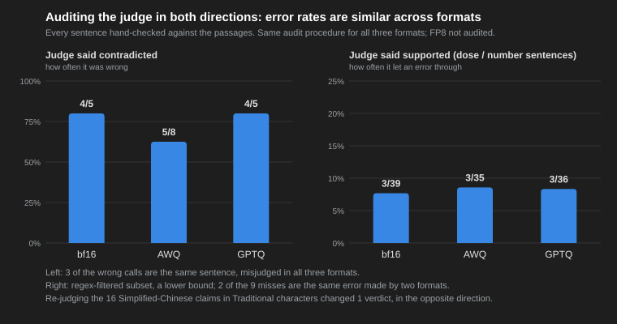

# The Engine Is Not the Variable — vLLM vs TensorRT-LLM vs Four Numeric Formats on One RTX 4090

> **2026-09-29.** All numbers from the SelectRAG decision memo §3–§4,
> measured on a single RTX 4090 (WSL2, Ubuntu 24.04) with the same 100 RAG prompts.
> Series: *SelectRAG — choosing a RAG configuration by experiment, not by faith* (2 of 2)

The question I wanted to answer sounded like an engine question: *on a consumer
GPU, is TensorRT-LLM worth the extra venv over vLLM?* Three weeks of controlled
runs later, the honest answer is that the engine was never the variable that
mattered. The numeric format was.

## Setup, so the numbers mean something

- **Model**: Qwen2.5-7B-Instruct, pinned to one revision; served through an
  OpenAI-compatible endpoint by either vLLM 0.22.1 or TensorRT-LLM 1.2.1
  (PyTorch backend, no engine build).
- **Workload**: 100 RAG prompts built by the project's own retrieval stack
  (hybrid + reranker, top-3 passages), greedy decoding, seed fixed. "Short
  answers" cap at 256 tokens (mean output ≈ 45 tokens); a second "long answer"
  set asks for section-by-section detail (mean ≈ 310 tokens).
- **Client**: one streaming client, SSE-parsed, measuring TTFT and end-to-end
  latency per request, tokens from `usage`, throughput on wall-clock time,
  concurrency 1 / 4 / 8, ten warm-up requests discarded.
- **Two traps we had to disarm first**: (1) the first request of every fresh
  vLLM process stalls for minutes while Triton JIT-compiles a kernel — measure
  after warm-up or your p95 is fiction; (2) vLLM silently applies the model's
  shipped `generation_config.json` (repetition penalty etc.), which TensorRT-LLM
  does not — pass `--generation-config vllm` or you are comparing different
  samplers.

## Result 1: same model, same card, engines within 10%

| Engine | bf16 c=1 latency p50 | bf16 c=8 tok/s | FP8 c=8 tok/s |
|---|---|---|---|
| vLLM | 0.73 s | 424 | 610 |
| TensorRT-LLM | 0.78 s | 385 | 645 |

bf16: vLLM leads by ≤ 10% at every concurrency. FP8: TensorRT-LLM leads by 6%.
Output-token counts per request are identical across engines (verified), so
throughput is comparable. Long-answer runs reproduce the same picture. The
scheduler differences people argue about did not show up at concurrency 8 on
a card this size — the GPU is simply not saturated.

**FP8 on Ada works in both engines** from a single ModelOpt checkpoint
(calibrated on 512 corpus chunks). That alone was worth ×1.4–1.7 — and at that
point the sensible advice became "do FP8 before you argue about engines".

## Result 2: the format axis dwarfs the engine axis

Then we ran the official pre-quantized AWQ and GPTQ-Int4 checkpoints under
vLLM (TensorRT-LLM's PyTorch backend cannot load HF-format W4 checkpoints —
"format is bound to engine" was the first hard limit we hit).

| Format (vLLM) | weights | KV cache (tokens) | c=8 tok/s | vs bf16 |
|---|---|---|---|---|
| bf16 | 14.3 GiB | 113k | 424 | ×1.00 |
| FP8 | 8.2 GiB | 224k | 610 | ×1.44 |
| AWQ (W4A16) | 5.3 GiB | 274k | 1000 | ×2.36 |
| GPTQ-Int4 | 5.3 GiB | 274k | 1000 | ×2.36 |

W4A16 through the Marlin kernel is the largest single speed-up in the whole
project: ×2.36 over bf16, ×1.6 over FP8, with 2.4× the KV-cache headroom. AWQ
and GPTQ are within 5% of each other — same GEMM path, different calibration
algorithm.

## Result 3: changed output is not lower quality — as far as one judge can see

The obvious worry: 4-bit must cost accuracy. We measured it two ways.

1. **Verbatim agreement with bf16** (greedy, same prompts): FP8 keeps 51% of
   outputs identical; AWQ 27%; GPTQ 25%. Quantization rewrites most answers.
2. **Faithfulness**, judged sentence by sentence by a local 14B judge:
   bf16 0.959, FP8 0.951, GPTQ 0.960, AWQ 0.938. Three
   settings decide what that number means, so here they are. First, the judge sees
   **all three retrieved passages**, not only the one an answer cites (a
   correct sentence with a wrong citation number is not penalised here).
   Second, the unit is the **whole sentence** (a sentence like "treats and
   prevents A, B and C" is supported if the passages support it read as a
   whole, even when one item is only listed for prevention). Third, the
   pipeline has a deterministic **verbatim shortcut**: a sentence that
   overlaps one passage almost character for character is marked supported
   without asking the LLM. The four scores above were produced **before**
   that shortcut existed, so every verdict in them is the LLM's. Re-running
   AWQ with the shortcut on moved exactly one sentence, from contradicted to
   supported, and lifted AWQ from 0.938 to 0.946.

We hand-audited every "contradicted" sentence for bf16, AWQ and GPTQ, the
same way each time. FP8's were **not** audited, so its score is raw judge
output:

| | judge: contradicted | real errors | retrieval artefact (shared) | judge mistakes |
|---|---|---|---|---|
| bf16 | 5 | 0 | 1 | 4 |
| AWQ | 8 | 2 | 1 | 5 (4 clear, 1 granularity call) |
| GPTQ | 5 | 0 (+1 pipeline artefact) | 0 | 4 |

The table covers only what the judge flagged. The *supported* side is
audited separately below.

The one "granularity call" is the treats-and-prevents sentence above: under
whole-sentence reading the judge is wrong; under atomic decomposition
(RAGAS-style) it would be right. So the audited gap is 2 real errors vs 0 —
one direction flip ("billed separately" answered as "included") and one
wrong abstention, where AWQ said "not mentioned" about a line bf16 answered
correctly. GPTQ has no real content error. Its one non-mistake is a dangling
abstention marker, written in Simplified characters, tacked onto an
otherwise correct answer. The version of the pipeline that produced these
scores did not yet recognise Simplified spellings of the marker, so the
dangling marker was sent to the judge as a claim. The fix landed the same
day; under the current code that sentence would leave the denominator. We
count it as a pipeline artefact, not a model error.

Chasing the retrieval artefact that is missing from the GPTQ row turned up
the audit's blind spot. On that question GPTQ wrote "2 tablets **per day**,
every 6 hours, for 5 days". The leaflet says "2 tablets, every 6 hours, for
5 days", which means 2 tablets per dose. GPTQ's version cuts the daily dose
by four and contradicts itself. The judge marked it *supported*, the exact
unit swap it is known to be blind to.

So we audited the supported side too, for all three formats. We took every
supported sentence that states a dose, a frequency, a duration or another
number with a unit (a regex filter; numbers written out in words slip
through, so this is a lower bound):

| | supported dose/number sentences | real errors the judge let through |
|---|---|---|
| bf16 | 39 | 3 |
| GPTQ | 36 | 3 |
| AWQ | 35 | 3 |

The nine misses share one shape: every word is in the passages, but the
relation between them is wrong:

- announcement date given as the start date ×2 (GPTQ and AWQ, same question)
- entity swap ×2 (bf16 and AWQ, same question)
- per-day/per-dose swap (GPTQ)
- frequency moved from one indication to another (GPTQ)
- two mutually exclusive categories merged into one rule (bf16)
- a rule that lost its required condition (bf16, borderline)
- a treatment condition filed as a diagnostic criterion (AWQ, borderline)

The one new type is the entity swap. A sentence copied
verbatim from the passages describes the long-acting injectable, while the
question asked about the take-home form. bf16 and AWQ made that same error
on the same question, and the judge let it through both times. That is the "which entity does
this claim refer to" question from the next section, failing on the
supported side. On this subset all three formats are level. With the two
borderline calls counted, that is three real errors each. Without them, it
is bf16 2, GPTQ 3, AWQ 2.

Three things that score does **not** cover, stated rather than hidden:

- **Bare abstentions.** An answer that is only the fixed marker ("not
  mentioned in the references") has no claim to judge, so it leaves the
  denominator. An abstention that names what is missing ("the passages do
  not state X") is a claim about the passages and stays in the
  denominator. That is how AWQ's wrong abstention in the table got judged.
  The bare-abstention counts were bf16 3, FP8 3, AWQ 1, GPTQ 3 out of 100.
  They are small here, but they are not neutral: in later demo runs (200
  answers, including a weaker BM25 preset and a different prompt), 11 of 21
  abstentions had the correct passage among the retrieved results. Those
  are errors the faithfulness score cannot see.
- **Broken entities.** In later GPTQ demo runs we saw decoding degrade
  around rare characters: garbled drug names, stray brackets, names that do
  not exist. A garbled drug name is not a contradiction, so a
  supported/contradicted judge does not flag it. In a medical setting it is
  as serious as a hallucination. The judge measures contradiction, not
  whether entities survive intact. A deterministic check can *detect* this
  by flagging passage terms that a sentence failed to copy verbatim. Unlike
  character drift, post-processing cannot *fix* it, because the correct
  name is gone.
- **Judge bias that depends on format.** See the next section.

## The part most posts leave out: how good is the judge?

The judge's agreement with a human on a random 30-question calibration set was
κ = 0.845, which looked reassuring for the wrong reason. Of the 14 unsupported
sentences in that set, 8 were altered numbers, the easiest error type there
is. Re-sampling 42 rows across four difficulty strata (verbatim, paraphrase,
low-overlap, abstention) dropped the same judge to κ = 0.488. Four explicit
prompt rules aimed at the nine observed error types changed **zero**
verdicts. Decomposing the judgement into three sub-questions flipped 3 of 8
errors. The "which entity does this claim refer to" question worked; unit
swaps ("2 tablets per day" vs "2 tablets per dose") did not.

We stopped there and wrote the limit into the memo: this judge is used for
*relative* comparison across formats, not for absolute quality claims. That
use rests on an assumption we have **not** verified: that the judge's errors
are the same size for every format. The audit gives evidence *for* it. Most
of the judge's "contradicted" calls were wrong in every format (4 of 5 on
bf16, 5 of 8 on AWQ, 4 of 5 on GPTQ). Three of GPTQ's four judge mistakes
are the same sentences the judge also got wrong under bf16 and AWQ. Those
errors are fixed per sentence, not per format. The supported side agrees:
the judge let through 3 wrong dose sentences in every format (of 39 on
bf16, 36 on GPTQ, 35 on AWQ). For these three formats, on both sides,
symmetry is now measured rather than assumed. FP8 was not audited. The fourth GPTQ mistake shows what the
judge cannot do. For one eligibility rule, GPTQ wrote the correct negation
of a threshold ("does not exceed 60%") and was marked contradicted. bf16
wrote a self-contradictory version ("not concentrated … and above 60%") and
was marked supported. That is the same blindness to numeric relations as the
unit swaps above.

One reason to doubt symmetry needed its own test. W4 quantization amplifies
Simplified-Chinese character drift in a Traditional-Chinese deployment. Out
of 100 answers, the number containing Simplified characters went from 2
under bf16 to 9 under AWQ and 6 under GPTQ, with up to 23% of the characters
in one answer. If the judge penalised Simplified text, the quantized formats
would be *under*-estimated. So we took every claim containing
Simplified-only characters (16: AWQ 8, GPTQ 6, bf16 2). We re-judged each
one twice in the same run, once as written and once converted to
Traditional, with the verbatim shortcut (see the settings above) switched
off. Converting to Traditional raises the character overlap, and with the
shortcut on, the shortcut rather than the LLM would decide. 15 of 16 verdicts did not move. The one that moved went the other
way. It was a bf16 abstention that names what is missing, and it became
*contradicted* after conversion. Every AWQ and GPTQ verdict, including the
one contradicted claim in each format, stayed the same. On this sample the
judge does not penalise Simplified characters. The sample is small, and the
character table is a lower bound, so this rules out a large bias, not a
small one.

The C-axis recommendation survives these caveats because it rests on
throughput plus audited gaps against bf16 on both sides. GPTQ has zero
extra errors on the contradicted side. AWQ has two. On the dose-and-number
part of the supported side, all three formats have three misses each. The broken entities above were also seen in GPTQ runs, and the audit
does not measure them either. A claim like "GPTQ is as good as bf16" does
not survive these caveats, and we do not make it. The drift itself
is caught by a deterministic character-table check with zero dependencies,
and post-processing fixes it — but you have to look for it.

## What I would tell a customer

- On a single consumer card, pick the **numeric format** first: W4A16 (GPTQ or
  AWQ) if you serve one model on one card; FP8 if you need one checkpoint that
  runs on both vLLM and TensorRT-LLM.
- Pick the engine second, and by operational cost: vLLM is a pip install;
  TensorRT-LLM buys 6% on FP8 for a second Python version, OpenMPI and a CUDA
  toolkit — and cannot load your HF W4 checkpoints.
- Do not quote "quality unchanged" without saying how you measured it: what
  the judge sees, what unit it judges, and what leaves the denominator
  (abstentions). Calibrate the judge on the hard cases, not on a random
  sample; a random sample full of altered numbers will flatter it.

Tables, per-format KV-cache numbers, the language-drift column and the eight
"expected to win, lost" entries are in the
[decision memo](../DECISION_MEMO.md).
